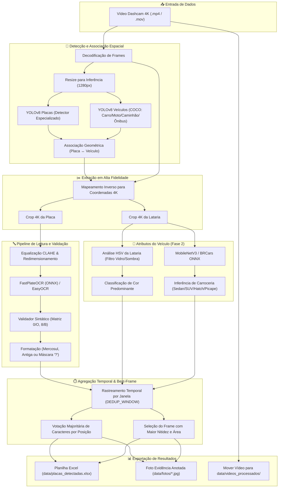

<div align="center">

# 🚗 Brazilian ALPR & Vehicle Recognition System (VMMR)

**Pipeline inteligente de Reconhecimento Automático de Placas (ALPR) e Veículos (VMMR) otimizado para vídeos de Dashcam em 4K com suporte completo aos padrões do Brasil (Mercosul e Antigo).**

[](https://www.python.org/)
[](https://pytorch.org/)
[](https://github.com/ultralytics/ultralytics)
[](https://github.com/ankandrew/fast-plate-ocr)
[](https://onnxruntime.ai/)
[](LICENSE)

</div>

---

## 📌 Visão Geral

Este projeto é um sistema modular e de alta precisão para processamento em lote (*batch processing*) de gravações de **dashcams** automotivas (como DDPAI, 70mai, VIOFO, entre outras). 

Projetado especialmente para enfrentar os desafios reais de câmeras veiculares — alta velocidade, vibração, reflexos de faróis, variação extrema de iluminação e distorção óptica —, o sistema localiza placas veiculares, lê seus caracteres com correção posicional sintática, identifica o tipo do veículo, estima a cor da lataria no espaço de cor HSV e infere o modelo/carroceria do carro, consolidando as evidências em uma **Planilha Excel** e em **Fotos anotadas em resolução máxima (4K)**.

---

## 🚀 Principais Diferenciais e Funcionalidades

### 1. 🇧🇷 Suporte Integral às Placas Brasileiras
O sistema reconhece e diferencia nativamente as duas categorias em circulação no Brasil:
* **Padrão Mercosul**: formato `LLLNLNN` (exemplo: `BRA2E19`).
* **Padrão Antigo (Cinza)**: formato `LLLNNNN` (exemplo: `ABC1234`).

### 2. 🧠 Desambiguação e Correção Sintática Posicional
Diferente de OCRs genéricos que frequentemente erram sob poeira ou trepidação, o validador aplica uma **matriz de substituição fonético-visual** associada à gramática estrita da placa:
* **Posições alfabéticas (0, 1, 2 e 4 no Mercosul)**: `0` $\rightarrow$ `O`, `1` $\rightarrow$ `I`, `2` $\rightarrow$ `Z`, `4` $\rightarrow$ `A`, `5` $\rightarrow$ `S`, `6` $\rightarrow$ `G`, `8` $\rightarrow$ `B`.
* **Posições numéricas (3, 5, 6 e 4 na antiga)**: `O`/`D`/`Q` $\rightarrow$ `0`, `I`/`L` $\rightarrow$ `1`, `Z` $\rightarrow$ `2`, `A` $\rightarrow$ `4`, `S` $\rightarrow$ `5`, `B` $\rightarrow$ `8`.
* **Critério de Mínima Alteração**: O algoritmo testa janelas deslizantes e só aceita correções que respeitem uma distância de edição mínima (até 2 correções de ruído), eliminando falsos positivos.

### 3. ❓ Leitura Parcial e Preenchimento com Máscara
Se uma placa estiver parcialmente obstruída (ex: reboque, estepe, sombra severa ou desfoque de movimento), o sistema não descarta a detecção. Ele alinha os caracteres legíveis e preenche as posições ambíguas com interrogações mantendo as 7 posições (ex: `ABC?D23`, `S4?????`, `???-????`).

### 4. 🔍 Pipeline Híbrido de Resolução (Crop em 4K Nativo)
* **Inferência de detecção leve**: Redimensionada para `RESIZE_WIDTH = 1280px` para altíssimo FPS e baixo consumo de VRAM/CPU.
* **Crop de OCR em 4K nativo**: A caixa delimitadora (*bounding box*) é remapeada proporcionalmente para as dimensões originais da câmera (ex: 3840x2160), garantindo a máxima densidade de pixels antes da ampliação e do pré-processamento CLAHE (*Contrast Limited Adaptive Histogram Equalization*).

### 5. 🗳️ Seleção de Melhor Frame (*Best-Frame Selection*) e Ensemble Temporal
Um mesmo veículo costuma aparecer em múltiplos quadros sucessivos. O motor de agregação rastreia o veículo ao longo de sua passagem e aplica:
* **Score de Qualidade**: Avalia proximidade do veículo, área da placa e confiança estatística do OCR.
* **Votação Majoritária por Coluna**: Cada posição da placa recebe votos independentes de cada frame. Se um caractere ficou ilegível em um quadro mas nítido em outro, a composição final reconstrói a placa correta com perfeição.

### 6. 🚘 Fase 2: Reconhecimento do Veículo (VMMR - Vehicle Make & Model)
* **Tipo do Veículo**: Mapeamento e filtragem de Carro, Moto, Caminhão e Ônibus através do modelo YOLOv8.
* **Estimativa de Cor da Lataria**: Análise no espaço de cores **HSV**, isolando uma região geométrica da lataria do veículo e eliminando reflexos de faróis/sol ($V > 240$), vidros e sombras de asfalto ($V < 30$), categorizando entre cores acromáticas (Preto, Branco, Prata/Cinza) e cromáticas (Vermelho, Azul, Amarelo/Laranja, Verde, Roxo/Vinho).
* **Inferência de Categoria / Carroceria**: Rede MobileNetV3 integrada que avalia a silhueta e proporções do veículo para classificar entre *Hatchback*, *Sedan*, *SUV / Utilitário*, *Picape* e *Minivan / Monovolume* (com suporte a modelos ONNX treinados no dataset BRCars).

---

## 🏗️ Arquitetura do Sistema



---

## 📁 Estrutura de Diretórios

```
alpr_project/
├── config.py                  # Parâmetros gerais (limiares, caminhos, GPU/CPU, resoluções)
├── main.py                    # Script principal de execução em lote
├── train_plate_model.py       # Script de fine-tuning do YOLOv8 com Roboflow Universe
├── requirements.txt           # Dependências do projeto
├── LICENSE                    # Licença MIT
├── README.md                  # Documentação do projeto
├── models/                    # Pesos de redes neurais
│   ├── placa_yolov8n.pt       # Modelo especializado em placas veiculares
│   └── car_model.onnx         # (Opcional) Classificador customizado BRCars
├── src/                       # Módulos do pipeline
│   ├── plate_detector.py      # Módulo YOLOv8 para detecção de placas e veículos
│   ├── ocr_reader.py          # Leitor OCR (FastPlateOCR, EasyOCR, PaddleOCR)
│   ├── validator.py           # Gramática veicular, matriz de confusão e máscara '?'
│   ├── vehicle_classifier.py  # Análise de cor HSV e classificação de carroceria
│   ├── video_processor.py     # Gerenciamento de frames, best-frame e votação temporal
│   ├── vehicle_saver.py       # Renderização de bounding boxes e salvamento de imagens
│   ├── spreadsheet_writer.py  # Gravação segura da planilha Excel (com fallback de lock)
│   ├── deduplicator.py        # Janela temporal de deduplicação
│   └── utils.py               # Extração de timestamp e parsing de metadados
└── data/                      # Armazenamento de mídia e saídas
    ├── videos_entrada/        # Coloque aqui os vídeos baixados da dashcam
    ├── videos_processados/    # Vídeos concluídos são movidos para cá automaticamente
    ├── fotos/                 # Imagens 4K anotadas com bounding boxes e dados
    ├── placas_detectadas.xlsx # Planilha consolidada de saída
    └── videos_processados.log # Log de vídeos já concluídos
```

---

## 🛠️ Guia de Instalação

### Pré-requisitos
* **Python**: 3.10 ou superior recomendado.
* **Sistema Operacional**: Windows 10/11 ou Linux (Ubuntu 20.04+).
* **GPU**: Placa de vídeo NVIDIA (opcional, mas altamente recomendada para processamento rápido).

---

### 1. Clonar o Repositório e Criar Ambiente Virtual

```bash
# Clone o repositório
git clone https://github.com/seu-usuario/alpr_project.git
cd alpr_project

# Crie o ambiente virtual
python -m venv venv

# Ative o ambiente virtual:
# No Windows (PowerShell):
venv\Scripts\Activate.ps1
# No Windows (CMD):
venv\Scripts\activate.bat
# No Linux / macOS:
source venv/bin/activate
```

---

### 2. Instalar Dependências

```bash
pip install --upgrade pip
pip install -r requirements.txt
```

---

### 3. Configuração de Aceleração por Hardware (GPU NVIDIA vs CPU)

#### Opção A: Com GPU NVIDIA (Recomendado - CUDA 12.x)
Para utilizar aceleração por GPU (ex: GTX 1050, RTX 20/30/40 ou servidores), instale o PyTorch compilado com suporte a CUDA:

```bash
# Instala PyTorch com suporte a CUDA 12.1
pip install torch torchvision --index-url https://download.pytorch.org/whl/cu121

# Para acelerar o FastPlateOCR via GPU no ONNX Runtime (opcional):
pip install onnxruntime-gpu
```

Valide se a GPU foi reconhecida executando:
```bash
python -c "import torch; print('CUDA disponível:', torch.cuda.is_available(), '| Dispositivo:', torch.cuda.get_device_name(0) if torch.cuda.is_available() else 'Nenhum')"
```

#### Opção B: Apenas CPU
O sistema possui fallback automático para CPU. Se nenhuma GPU for encontrada ou se `USE_GPU = False` for definido em `config.py`, o pipeline funcionará normalmente via processamento multinúcleo da CPU.

---

### 4. Modelo de Detecção de Placas

O projeto é configurado por padrão para usar um modelo YOLOv8 nano especializado em placas brasileiras (`models/placa_yolov8n.pt`).

Caso queira treinar novamente ou atualizar o modelo usando o dataset aberto [Roboflow Universe License Plates](https://universe.roboflow.com/roboflow-universe-projects/license-plate-recognition-rxg4e):

1. Obtenha uma chave gratuita no [Roboflow](https://app.roboflow.com/).
2. Defina a variável de ambiente:
   ```powershell
   $env:ROBOFLOW_API_KEY="sua_chave_aqui"    # PowerShell
   set ROBOFLOW_API_KEY=sua_chave_aqui       # CMD
   export ROBOFLOW_API_KEY=sua_chave_aqui    # Linux
   ```
3. Execute o treinamento automatizado:
   ```bash
   python train_plate_model.py
   ```
O script baixará o dataset, treinará a rede por 60 épocas e moverá o melhor peso (`best.pt`) automaticamente para `models/placa_yolov8n.pt`.

---

## 🚦 Como Usar

### 1. Inserir os Vídeos
Copie os arquivos de vídeo gravados pela dashcam (`.mp4`, `.mov`, `.avi`, `.mkv`) para o diretório:
```
data/videos_entrada/
```

### 2. Executar o Pipeline
Execute o script central:
```bash
python main.py
```

### 3. Acompanhar a Execução
O terminal exibirá em tempo real:
* Identificação dos vídeos pendentes.
* Progresso da leitura e contagem de frames processados.
* Detecções consolidadas com placa, tipo de veículo, cor estimada e confiança do OCR.
* Movimentação automática do vídeo para `data/videos_processados/` ao término, garantindo idempotência (vídeos já processados não são reexecutados).

---

## ⚙️ Parâmetros de Configuração (`config.py`)

Todos os parâmetros ajustáveis estão centralizados em [`config.py`](file:///e:/alpr_project/config.py):

| Parâmetro | Padrão | Descrição e Recomendações |
| :--- | :---: | :--- |
| `MODEL_TYPE` | `"plate"` | `"plate"` (modelo treinado em placas) ou `"vehicle"` (modelo genérico COCO). |
| `YOLO_MODEL_PATH` | `models/placa_yolov8n.pt` | Caminho do arquivo de pesos do detector de placas. |
| `YOLO_CONFIDENCE` | `0.40` | Limiar mínimo de confiança da rede YOLO para considerar uma placa. |
| `FRAME_SKIP` | `1` | Intervalo de amostragem de frames. Use `1` para examinar 100% dos quadros e obter o frame mais nítido, ou aumente para `3`-`5` em CPUs modestas. |
| `RESIZE_WIDTH` | `1280` | Largura da imagem durante a inferência YOLO (o recorte do OCR sempre usa a resolução 4K nativa). |
| `USE_GPU` | `True` | Ativa CUDA caso haja hardware disponível (cai suavemente para CPU se indisponível). |
| `OCR_ENGINE` | `"fast_plate_ocr"` | Motor de leitura: `"fast_plate_ocr"` (rápido, baseado em ONNX), `"easyocr"` ou `"paddleocr"`. |
| `OCR_MIN_CONFIDENCE` | `0.10` | Confiança mínima aceita do OCR. |
| `DEDUP_WINDOW_SECONDS`| `60` | Janela de tempo (em segundos) para agrupar leituras do mesmo veículo em um único evento. |
| `CAR_CLASSIFIER_ENABLED`| `True` | Habilita a Fase 2 (inferência de cor HSV, tipo e categoria de carroceria). |

---

## 📋 Formato das Saídas Geradas

### 1. Planilha Excel Consolidada (`data/placas_detectadas.xlsx`)
Cada linha representa um veículo consolidado no vídeo:

| Placa | Tipo | Cor | Marca / Modelo | Data | Hora | Confiança OCR | Foto | Vídeo de origem |
| :--- | :--- | :--- | :--- | :---: | :---: | :---: | :--- | :--- |
| **BRA2E19** | Carro | Prata / Cinza | Sedan | 04/11/2026 | 14:32:10 | 0.94 | `data/fotos/BRA2E19_2026-11-04_14-32-10.jpg` | `NO20261104-143000.MP4` |
| **NXZ9F22** | Carro | Branco | Hatchback | 04/11/2026 | 14:32:45 | 0.88 | `data/fotos/NXZ9F22_2026-11-04_14-32-45.jpg` | `NO20261104-143000.MP4` |
| **ABC?D23** | Caminhão | Azul | Caminhão | 04/11/2026 | 14:33:02 | 0.72 | `data/fotos/ABC_D23_2026-11-04_14-33-02.jpg` | `NO20261104-143000.MP4` |

> [!NOTE]
> Se o arquivo `placas_detectadas.xlsx` estiver aberto no Microsoft Excel no momento da execução, o sistema automaticamente salva em um arquivo alternativo (`placas_detectadas_atualizado.xlsx`) para evitar erros de bloqueio de escrita (*PermissionError*).

### 2. Fotos Anotadas (`data/fotos/`)
As imagens salvas preservam a resolução máxima capturada pela câmera com sobreposições vetoriais de alto contraste:
* 🟦 **Retângulo Ciano**: Enquadramento do corpo do veículo com etiqueta indicando Tipo, Cor e Carroceria.
* 🟩 **Retângulo Verde**: Enquadramento exato da placa com etiqueta exibindo a placa identificada e formatada.
* 🏷️ **Nomenclatura Padronizada**: `PLACA_AAAA-MM-DD_HH-MM-SS.jpg` (com caracteres especiais sanitizados para compatibilidade com qualquer sistema de arquivos).

---

## 🤝 Contribuições

Contribuições, correções de bugs e novas ideias são muito bem-vindas!
1. Faça um Fork do projeto
2. Crie uma branch para sua funcionalidade (`git checkout -b feature/nova-funcionalidade`)
3. Faça o commit de suas alterações (`git commit -m 'feat: Adiciona suporte a novo modelo de OCR'`)
4. Envie para o GitHub (`git push origin feature/nova-funcionalidade`)
5. Abra um Pull Request

---

## 📄 Licença

Distribuído sob a licença **MIT**. Consulte o arquivo [`LICENSE`](LICENSE) para obter mais informações.
