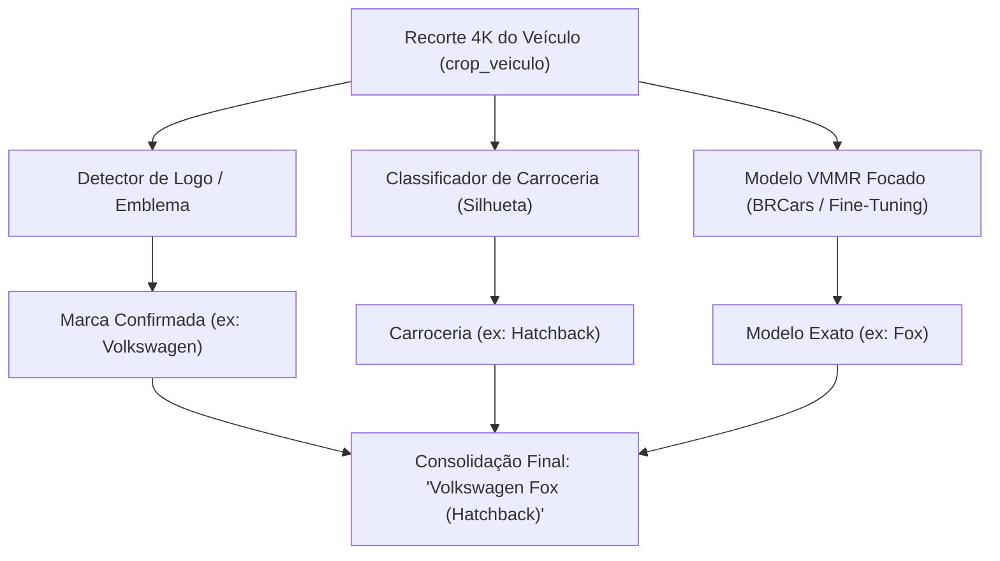

# 🇧🇷 Guia de Reconhecimento de Marca e Modelo Veicular (VMMR) no Brasil

Este documento consolida a arquitetura técnica recomendada e os principais datasets e modelos públicos do **Roboflow Universe** voltados para o cenário da frota automotiva brasileira.

---

## 📌 O Desafio do VMMR no Brasil

No Roboflow Universe e na literatura de visão computacional, o reconhecimento de veículos (**VMMR – Vehicle Make and Model Recognition**) possui uma particularidade crítica:

> [!IMPORTANT]
> **Não existe um modelo único, público e pronto** que cubra de ponta a ponta toda a frota específica de modelos brasileiros (*Onix, HB20, Gol, Fox, Strada, Palio, Mobi, Argo*, etc.) com alta precisão.
> A grande maioria dos modelos globais foi treinada em bases norte-americanas ou europeias (como o *Stanford Cars Dataset*), que desconhecem os carros populares da América Latina.

A solução profissional adotada pela indústria combina **modelos modulares em múltiplos estágios** e **detecção de emblemas de montadoras**.

---

## 🏛️ Arquitetura em Múltiplos Estágios Recomendada



---

## 🌐 Repositórios Selecionados no Roboflow Universe

### 1. Reconhecimento de Marca por Emblemas / Logos (Prontos para Uso)
Como as montadoras que operam no Brasil (*Volkswagen, Fiat, Chevrolet, Hyundai, Toyota, Renault, Jeep, Ford, Honda*, etc.) utilizam os mesmos emblemas globalmente, os modelos de detecção de logos funcionam com máxima fidelidade na frota nacional:

* **[Logo de marcas de carros (FIAP 2TDSPK)](https://universe.roboflow.com/fiap-2tdspk/logo-de-marcas-de-carros)**:
  * Projeto brasileiro focado especificamente na detecção de emblemas das marcas mais comuns nas ruas do país.
* **[Car brand logo (FYP)](https://universe.roboflow.com/fyp-hjsha/car-brand-logo)**:
  * Um dos maiores e mais testados datasets públicos para marcas, com mais de 5.000 imagens e modelo pré-treinado.
* **[Car Brand Detection (Test1)](https://universe.roboflow.com/test1-iokid/car-brand-detection-pnb7u)**:
  * Divide as classes entre o carro inteiro (`volkswagen-car`, `fiat-car`, `chevrolet-car`) e o logotipo (`volkswagen-logo`, `fiat-logo`, `chevrolet-logo`), permitindo identificar a montadora mesmo sob ângulos variados.

---

### 2. Reconhecimento de Modelo Específico (VMMR Geral)
Classificadores para veículos globais que também possuem forte circulação no Brasil (*Corolla, Civic, Compass, Ranger, Golf, Renegade, Hilux*):

* **[Car Make-Model Recognition (Car MakeModel)](https://universe.roboflow.com/car-makemodel/car-make-model-recognition-q0kvx)**:
  * Focado em inferir marca e modelo diretamente do recorte (*crop*) do veículo.
* **[Car Make Model Recognition Clean](https://universe.roboflow.com/car-makemodel/car-make-model-recognition-clean)**:
  * Dataset higienizado focado em orientação espacial, marca e modelo.

---

### 3. Detecção de Placas Brasileiras (ALPR de Alta Densidade)
Bases brasileiras robustas para treinar ou aprimorar detectores YOLOv8/YOLOv11:

* **[Plates-BR (UFAM)](https://universe.roboflow.com/teste-kk4uk/plates-br-vfdj7)**:
  * Mais de 21.000 imagens de veículos brasileiros com anotações de placas (Mercosul e cinza).
* **[Brazil Car Plates (Placas BR)](https://universe.roboflow.com/placas-br/brazil-car-plates)**:
  * Focado em placas automotivas em condições reais de tráfego.
* **[Placas Brasileiras (AlfaScan)](https://universe.roboflow.com/alfascan/placas_brasileiras)**:
  * Excelente para isolar a região exata da placa em alta velocidade.

---

## 🛠️ Como Estruturar o Pipeline no Nosso Software

1. **Estágio 1 (Detecção e Crop)**:
   - O detector YOLOv8 localiza o veículo e a placa no frame 4K, gerando `crop_veiculo` e `crop_placa`.
2. **Estágio 2A (Marca pelo Emblema)**:
   - Um detector leve de logos isola o emblema na traseira/grade e confirma a marca (*ex: Volkswagen*).
3. **Estágio 2B (Silhueta / Carroceria)**:
   - A análise de proporções geométricas (largura/altura) e rede neural classifica a carroceria (*ex: Hatchback*).
4. **Estágio 2C (Modelo Específico via BRCars)**:
   - O classificador treinado com o dataset nacional BRCars-196 fecha o diagnóstico com o modelo exato (*ex: Fox*).
5. **Estágio 3 (Consolidação)**:
   - A planilha Excel e as fotos 4K são gravadas com a tripla confirmação: **Marca**, **Modelo** e **Carroceria**.

---

## 📚 Citação Oficial do BRCars

Para trabalhos acadêmicos ou relatórios que utilizem a base de dados BRCars:

```bibtex
@inproceedings{kuhn2021brcars,
  title={BRCars: a Dataset for Fine-Grained Classification of Car Images},
  author={Kuhn, Daniel M and Moreira, Viviane P},
  booktitle={2021 34nd SIBGRAPI Conference on Graphics, Patterns and Images (SIBGRAPI)},
  year={2021},
  organization={IEEE}
}
```
